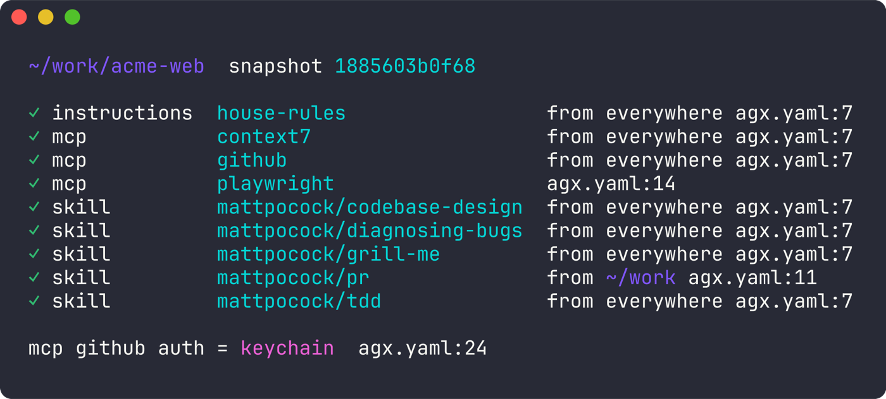

<div align="center">

# agx

**One config for every coding agent.**<br>
Skills, MCP servers, and instructions — scoped to the directory you're in.

Codex · Claude Code · Pi

[](https://github.com/tarik02-org/agx/actions/workflows/ci.yml)
[](https://github.com/tarik02-org/agx/releases)



</div>

## What it looks like

```yaml
# ~/.config/agx/agx.d/main.yaml, listed in agx.yaml
packages:
  mattpocock:
    git: https://github.com/mattpocock/skills.git

mcp:
  context7:   { url: https://mcp.context7.com/mcp, auth: none }
  github:     { url: https://api.githubcopilot.com/mcp/, auth: keychain }
  playwright: { command: [npx, -y, '@playwright/mcp@latest'] }

instructions:
  house-rules:
    text: Use pnpm, not npm. Write conventional commits.

scopes:
  - add:                                  # everywhere
      skills: [mattpocock/tdd, mattpocock/grill-me, mattpocock/diagnosing-bugs]
      instructions: [house-rules]
      mcp: [context7, github]
  - directory: ~/work                     # work projects only
    add:
      skills: [mattpocock/pr]
  - directory: ~/work/acme-web            # just this repo
    add:
      mcp: [playwright]
```

```console
$ cd ~/work/acme-web
$ agx claude   # 4 skills, house rules, context7 + github + playwright
$ agx codex    # same
$ agx pi       # same

$ cd ~/oss/blog
$ agx claude   # no pr skill, no playwright
```

## Features

<table>
<tr>
<td width="33%" valign="top">

**📁 Directory scopes**<br>
Add or remove anything for a folder and everything below it. Work repos get work tools; personal ones stay clean.

</td>
<td width="33%" valign="top">

**📦 Skills from Git**<br>
`agx skill add mattpocock/skills` — pick skills, lock the commit, `agx update` later.

</td>
<td width="33%" valign="top">

**🔌 MCP for every harness**<br>
HTTP and stdio servers, defined once and served to Codex, Claude Code, and Pi.

</td>
</tr>
<tr>
<td valign="top">

**🔐 No tokens in files**<br>
Keychain secrets and OAuth logins, held by a local daemon. Agents never see them.

</td>
<td valign="top">

**🔍 Explainable**<br>
`agx explain` shows every resource a directory gets and the line that decided it.

</td>
<td valign="top">

**⏯ Launcher**<br>
Run `agx` to start an agent or resume any past session, from any harness.

</td>
</tr>
</table>

## Install

Download `agx` from the [releases page](https://github.com/tarik02-org/agx/releases) and put it on your `PATH`.

<details>
<summary><b>macOS: first run</b></summary>

Clear the quarantine flag once:

```sh
xattr -d com.apple.quarantine ./agx
```
</details>

<details>
<summary><b>mise</b></summary>

```sh
mise use -g github:tarik02-org/agx
```
</details>

<details>
<summary><b>Nix</b></summary>

```sh
nix profile install github:tarik02-org/agx
```
</details>

<details>
<summary><b>Home Manager</b></summary>

The flake's `homeManagerModules.default` installs agx and writes `programs.agx.settings`
to the drop-in `agx.d/10-home-manager.yaml`, validated at build time; `settings.daemon`
goes to the root `agx.yaml` instead:

```nix
{ config, pkgs, ... }: {
  imports = [ inputs.agx.homeManagerModules.default ];
  programs.agx = {
    enable = true;
    settings.mcp.docs = {
      url = "https://docs.example.com/mcp";
      headers.X-Api-Key = config.lib.agx.secret "docs-key"; # !secret docs-key
    };
    harnesses.codex.package = pkgs.codex; # `codex` runs through agx
  };
}
```

`config.lib.agx` also has `env`, `file`, and `tag`. Activation runs `agx shims install`
and the shims directory goes on `PATH` (`shims.enable`). Each `harnesses.<name>` entry
installs a `<name>` link to agx (`link`) and pins its `executable` to the package.
</details>

<details>
<summary><b>Go 1.26+</b></summary>

```sh
go install github.com/tarik02-org/agx/cmd/agx@latest
go install github.com/tarik02-org/agx/cmd/agxd@latest
```
</details>

Install `agx` and `agxd` from the same version into the same directory. Release
archives and Nix packages include both. `agx` is the client; `agxd` owns the
database and runs in the background. See [daemon setup](docs/daemon.md) for a
custom executable location or service manager.

## Get started

```sh
agx skill add mattpocock/skills --skill tdd --skill grill-me
agx mcp add context7 https://mcp.context7.com/mcp --auth none
agx mcp add playwright --scope here -- npx -y @playwright/mcp@latest
agx explain
agx claude
```

Commands save local configuration through the daemon in SQLite; YAML overlays remain authoritative. Continue with the [getting started guide](docs/getting-started.md).

## Integrations

Any tool that starts Codex, Claude Code, or Pi can run them through agx: point it at a [shim](docs/harnesses.md#shims) instead of the agent's own binary. See [Integrations](docs/integrations.md) for [T3 Code](docs/integrations.md#t3-code).

## Docs

[Getting started](docs/getting-started.md) · [Configuration](docs/configuration.md) · [Harnesses](docs/harnesses.md) · [MCP servers](docs/mcp.md) · [Skills & packages](docs/skills-and-packages.md) · [Secrets](docs/secrets.md) · [Sessions](docs/sessions.md) · [Integrations](docs/integrations.md) · [Daemon](docs/daemon.md) · [Troubleshooting](docs/troubleshooting.md) · [Security](docs/security.md) · [CLI reference](docs/cli-reference.md)

Working on agx itself? See the [development notes](docs/development/README.md) and the [changelog](CHANGELOG.md).

<sub>MIT licensed</sub>
